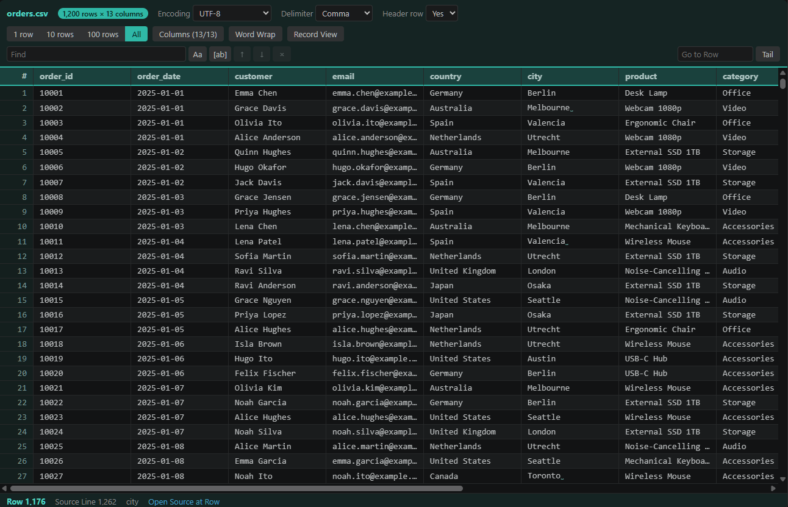
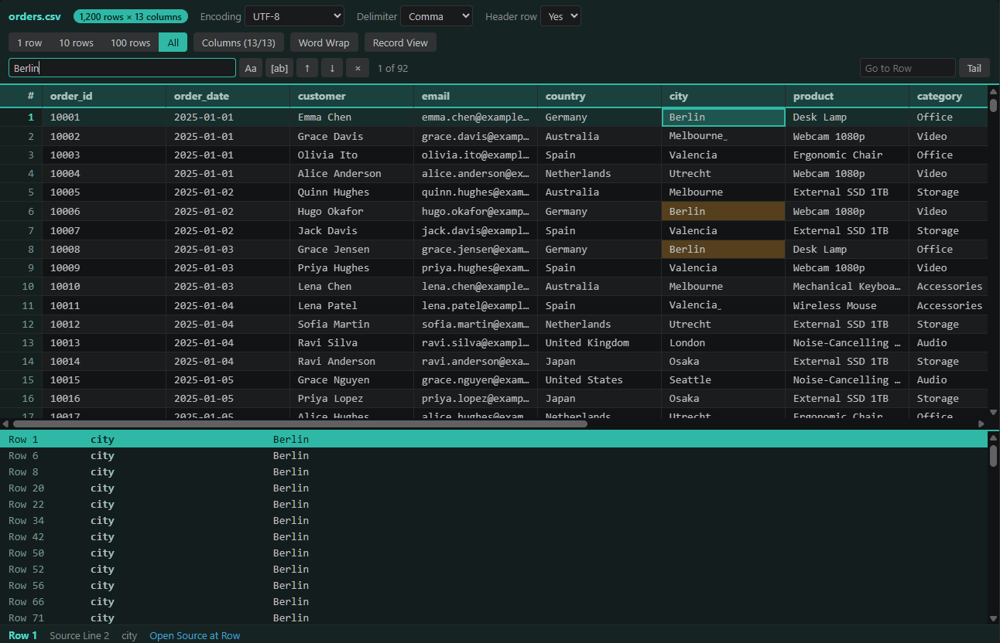
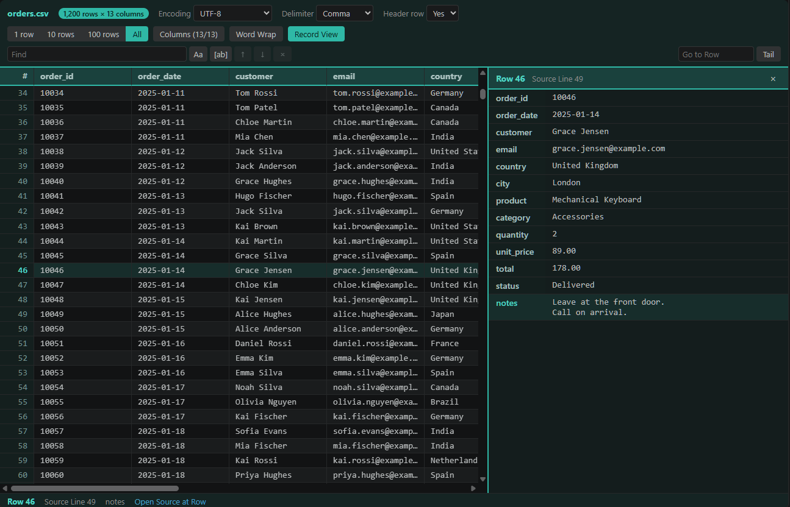
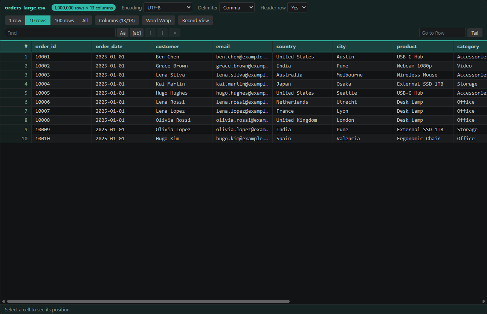

# CSV Loupe

[日本語](README.ja.md)

A viewer for developers who want to check what is inside a CSV or TSV file, including large ones. It does not edit or analyze the data. It shortens the time from "what is in this file?" to the answer.

## Features

- **Read-only**: opens `.csv` and `.tsv` files as a table by default and never writes to the file.
- **Opens large files immediately**: no "this file is large, open anyway?" prompt. The header and the first rows appear right away, and CSV Loupe counts the rows in the background.
- **Encoding detection**: UTF-8, UTF-8 with BOM, UTF-16 LE / BE, and Shift_JIS (CP932). CSV Loupe marks a guessed encoding with `?`, and you can switch it from the toolbar.
- **Delimiter**: comma for `.csv` and tab for `.tsv`. You can switch to comma, tab, semicolon, or pipe.
- **Header detection**: CSV Loupe compares the first record with the rest to decide whether it is a header. When the file starts with a title or other rows above the table (common in files exported from spreadsheets), CSV Loupe skips those rows and uses the next one as the header. When it cannot tell, it shows `?` on the toolbar. You can choose the header row (None, or record 1 to 10) from the toolbar. Rows above the header are not shown. Without a header, CSV Loupe names the columns "Column 1", "Column 2", and so on.
- **Quick Peek**: show 1, 10, or 100 rows to check the structure, or all rows with virtual scrolling.
- **Table**: sticky header, row numbers, resizable columns, word wrap, and highlight of the selected cell and row. CSV Loupe trims leading and trailing spaces in cell values and shows a marker in their place.
- **Sort**: click a column header to sort by that column, in ascending order, descending order, and then the original order.
- **Columns**: show and hide columns from the column list on the toolbar. You can filter the list by column name.
- **Find**: searches the whole file, including rows not shown yet, highlights the matches in the table, and moves between them. Partial match and case-insensitive by default, with options for match case and whole cell. Turn on **Filter** to show only the rows that match (you can still sort them). Row numbers stay the same as in the whole file. Clear the search with the × button or `Esc`.
- **Find Same Value**: finds cells whose whole value matches the selected cell (case-sensitive), across all rows and columns.
- **Record View**: shows one row vertically as column name and value pairs.
- **Go to Row and Tail**: jump to a row number or to the last rows.
- **Source location**: shows the Row and the line in the source file, and opens the file in the text editor at that line.
- **File change notice**: when the file changes on disk, CSV Loupe shows a notice with a **Reload** button.
- **Colors**: its own color scheme with an accent color and alternating row colors, following the light or dark theme. Choose purple (default), teal, blue, green, amber, rose, gray, or the VS Code theme colors from the toolbar or the `csvLoupe.colorTheme` setting. High contrast themes use the theme colors.

## Screenshots

### Find

Searches the whole file and highlights each match in the table.

### Record View

Shows the selected row vertically, including values with line breaks.

### Large files

Opens a 1,000,000-row file (about 130 MB) without a confirmation prompt.

## Usage

1. Open a `.csv` or `.tsv` file. It opens in CSV Loupe.
2. Choose the number of rows to show (1 / 10 / 100 / All) from the toolbar.
3. Right-click a cell for **Copy Cell**, **Copy Row**, **Find Same Value**, **Open Record View**, and **Open Source at Row**.

- `Ctrl+F` (`Cmd+F`) moves to the Find box. `Enter`, `↓`, or `F3` moves to the next match, and `Shift+Enter`, `↑`, or `Shift+F3` to the previous one. `F3` and `Shift+F3` also work outside the Find box.
- `Ctrl+C` (`Cmd+C`) copies the selected cell.
- Double-click a cell, or press `Enter`, to open **Record View** for its row.
- When the table has focus, move the selected cell with the keyboard. Moves stay within the rows shown, in the sorted order while sorted.

| Key | Moves to |
| --- | --- |
| `↑` / `↓` | The row above or below |
| `←` / `→` | The column on the left or right (hidden columns are skipped) |
| `PageUp` / `PageDown` | One screen up or down |
| `Home` / `End` | The first or last column of the row |
| `Ctrl+Home` / `Ctrl+End` | The first or last row (`Ctrl+End` is available after row counting finishes) |

- To edit the file as text, run **View: Reopen Editor With...** and choose **Text Editor**.

## Settings

| Setting | Default | Description |
| --- | --- | --- |
| `csvLoupe.initialRowCount` | `10` | Number of rows shown when a file is opened (`1` / `10` / `100` / `all`). Applies to files opened after the change. |
| `csvLoupe.colorTheme` | `purple` | Color theme (`purple` / `teal` / `blue` / `green` / `amber` / `rose` / `gray` / `vscode`). `vscode` follows the VS Code theme colors without an accent color. You can also change it from the toolbar. Applies to all open editors. |

## Notes

- Go to Row, Tail, and sorting become available after CSV Loupe finishes counting rows.
- Sorting is available for files with up to 1,000,000 rows.
- Line breaks must be LF or CRLF. CSV Loupe does not support files that use CR as the line break.
- CSV Loupe loads files outside the local file system (for example, virtual file systems) into memory as a whole.

## Requirements

- Visual Studio Code 1.138 or later

## License

[MIT](LICENSE)
